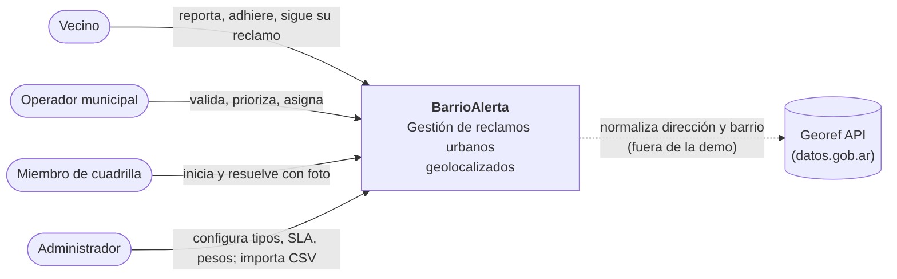
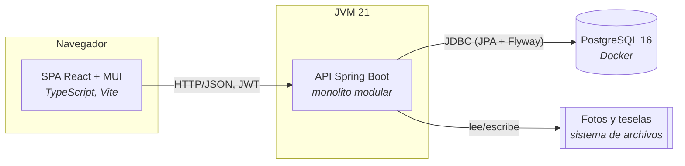
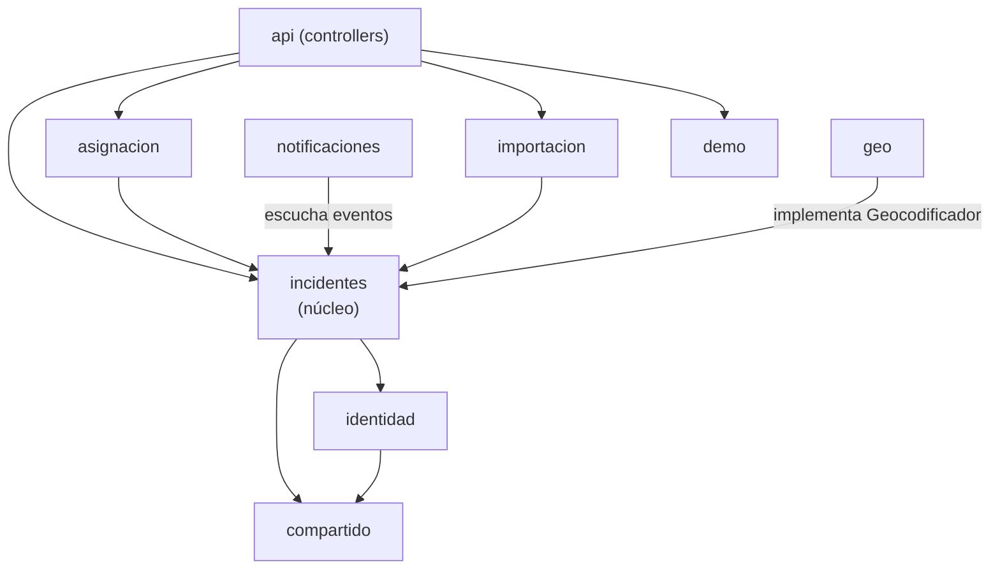

# Documento de arquitectura — BarrioAlerta (v0)

Resumen operativo de las decisiones D1–D12 del [lineamiento](../../LINEAMIENTO_TP_DSI.md#5-decisiones-de-diseño-con-trade-offs). Sigue el modelo **C4** (C22 · Documentación de Arquitectura): contexto → contenedores → componentes → código.

## 1. Contexto (C4 nivel 1)

## 2. Contenedores (C4 nivel 2)

## 3. Módulos y dirección de dependencias (C4 nivel 3)

Las flechas indican "depende de". **No hay ciclos.** Lo verifica `ArquitecturaTest` (ArchUnit) en cada build.

| Módulo | Responsabilidad | Patrones | Dueño |
|---|---|---|---|
| `compartido` | Excepciones base, manejo de errores HTTP, salud, reloj | — | I7 |
| `identidad` | Usuarios, roles, permisos, JWT | — | I7 |
| `incidentes` | Agregado `Incidente`, estados, auditoría, SLA, cuadrillas, priorización, puertos | State, Strategy, eventos, Repository | I1, I2 |
| `asignacion` | Propuestas de cuadrilla | Strategy, Simple Factory | I3 |
| `notificaciones` | Reacción a eventos, canales | Observer/Pub-Sub, Facade, Adapter, Factory | I4 |
| `importacion` | CSV masivo | Template Method | I7 |
| `geo` | Geocodificación | Adapter (puertos y adaptadores) | I7 |
| `demo` | Reloj controlable, reset | DIP con `Clock` | I7 |

**Capas dentro de cada módulo** (D3): `api` (controllers delgados, DTOs) → `aplicacion` (servicios: transacción, permisos, publicación de eventos) → `dominio` (reglas, sin Spring) ← `infraestructura` (JPA, adaptadores). El dominio solo puede usar anotaciones `jakarta.persistence` (a partir de H1). ArchUnit prohíbe que dependa de `org.springframework`, de `api` o de `infraestructura`.

## 4. Escenarios de atributos de calidad (QAW liviano)

Formato: fuente → estímulo → artefacto → respuesta → **medida** (C08 · Caso de estudio: "cuantificar los atributos de calidad").

| # | Atributo (ISO 25010) | Escenario | Medida | Decisiones que lo soportan |
|---|---|---|---|---|
| E1 | Fiabilidad | Durante la demo, el operador asigna una cuadrilla y el canal de WhatsApp simulado falla | La asignación se confirma igual; la falla queda en el log | D7 (eventos después del commit, `@Async`) |
| E2 | Eficiencia | 20 usuarios consultan el mapa con 10.000 históricos | P95 < 500 ms | D8 (desnormalización, índices, caja delimitadora) |
| E3 | Mantenibilidad | Se pide un tercer criterio de asignación | Se agrega 1 clase, 0 clases modificadas | D6 (Strategy + registro) |
| E4 | Portabilidad | Se corta internet en el aula | El guion completo funciona igual | D11 (geocodificador offline), teselas locales, canales simulados |
| E5 | Seguridad | Un vecino intenta asignar una cuadrilla llamando a la API | HTTP 403 y nada cambia | D12 (roles y permisos en la capa de aplicación) |
| E6 | Fiabilidad | El tiempo real pasa durante la exposición | No ocurre ningún escalamiento no planificado | D10 (`RelojDeDemo`) |

## 5. Trade-offs aceptados

| Decisión | Ganamos | Perdemos (y por qué está bien) |
|---|---|---|
| Monolito modular (D2) | Una sola cosa que arrancar; demo robusta | Escalado independiente. No hay carga que lo pida y los módulos sin ciclos permiten extraer servicios después. |
| Eventos en proceso sin broker (D7) | Cero infraestructura extra | Si el proceso cae entre el commit y el envío, se pierde una notificación. La evolución es Transactional Outbox. |
| JPA en el dominio (D3) | Sin duplicar clases ni mapeos | Pureza hexagonal. Se acota permitiendo solo `jakarta.persistence`. |
| SPA en lugar de SSR (D4) | Interactividad del mapa y del tablero; API reutilizable | Primera carga y SEO, que no aplican a esta app. |
| Sin PostGIS (D8) | Una dependencia menos | Consultas geográficas avanzadas. Con ~10.000 filas alcanza con caja delimitadora + Haversine. |
