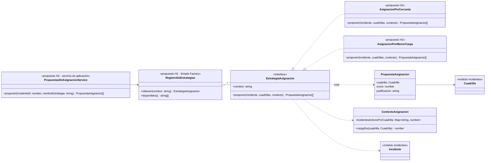

# Diagrama de clases — Módulo Asignación

**Estado:**
- **Implementado** (en `asignacion/dominio`): `EstrategiaAsignacion`, `PropuestaAsignacion` y `ContextoAsignacion`.
- **Propuesto** (H2, I3): las estrategias concretas y el servicio.

## Reglas para las implementaciones (H2)

- **Solo** se proponen cuadrillas con `cuadrilla.puedeAtender(incidente.tipo)`.
- Se devuelven como máximo 3 propuestas, ordenadas por `score` descendente, con `score` en [0, 1] y una `justificacion` legible (por ejemplo, "A 420 m de la base").
- `AsignacionPorCercania`: `score = 1 − min(distancia / 5000 m, 1)` usando `Ubicacion.distanciaMetrosA`.
- `AsignacionPorMenorCarga`: `score = 1 / (1 + carga)` con `contexto.cargaDe(cuadrilla)`.
- Las estrategias se crean en la raíz de composición (`app.ts`) y `RegistroDeEstrategias` las indexa por `nombre`. Agregar una nueva no modifica clases existentes (OCP, RNF8).
- **State ≠ Strategy:** el incidente no elige su estrategia. La elige el operador en la UI.
