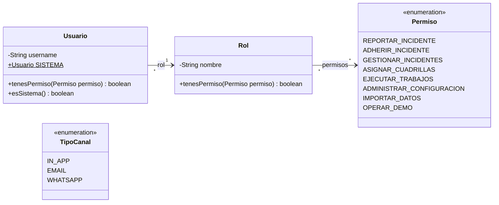
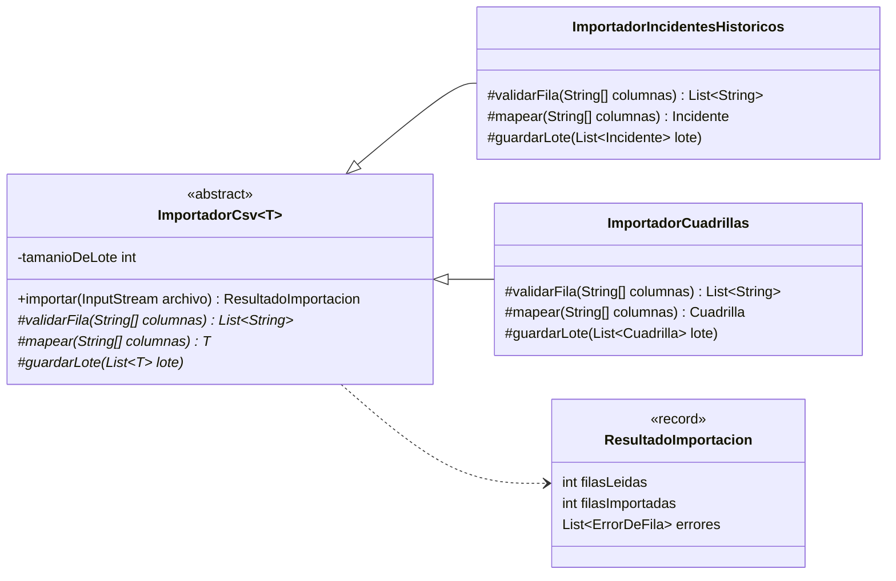
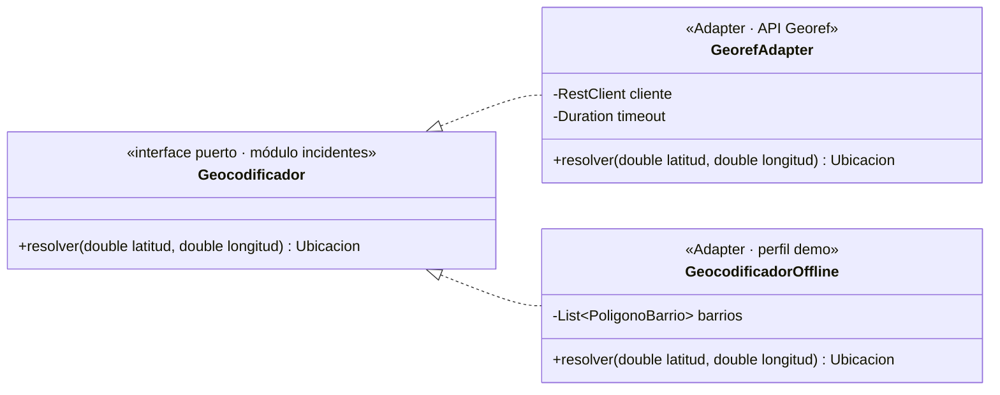

# Diagrama de clases — Identidad, Importación y Geo

**Estado:**
- **Identidad:** implementado (`identidad/dominio`). Login JWT en H1.
- **Importación y Geo:** propuestos (H3, I7).

## Identidad (C04 · usuarios, roles y permisos)

> Operador y Admin no son clases: son roles. Solo tienen entidad propia los actores con relaciones de dominio (`Vecino`, miembros de `Cuadrilla`), como plantea C04.

## Importación CSV — Template Method (C03)

`importar()` es el algoritmo fijo (y `final`): leer → validar fila → mapear → acumular → guardar en lotes de 500 → reportar errores por número de fila. Las subclases solo definen los pasos variables.

## Geo — puerto y adaptadores (C06 · Adapter; C22 · Hexagonal)

`GeorefAdapter` traduce la respuesta de `GET /ubicacion?lat=&lon=` (C02 · SmartLife) a `Ubicacion`. El perfil `demo` usa `GeocodificadorOffline` para no depender de internet.
