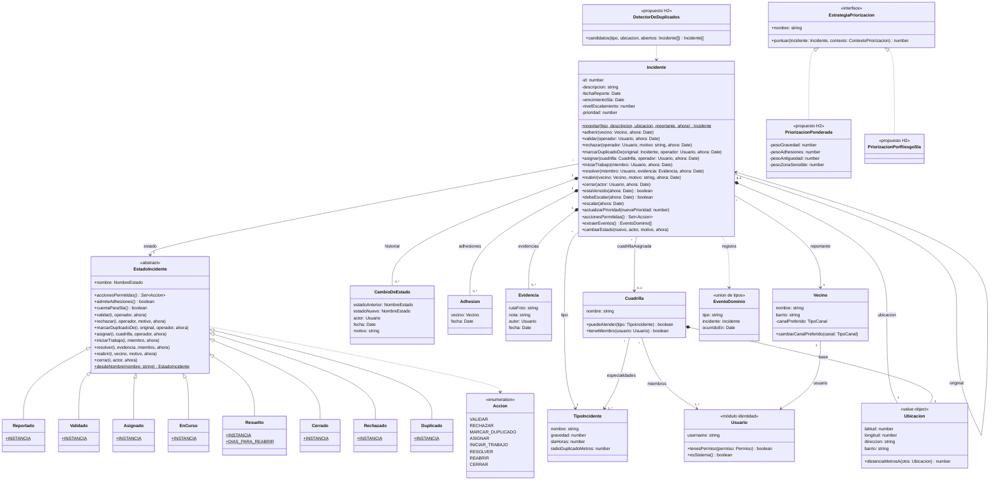

# Diagrama de clases — Módulo Incidentes (núcleo)

**Estado:** el dominio está implementado en `backend/src/incidentes/dominio`. Las estrategias concretas de priorización y el `DetectorDeDuplicados` son **propuestos** (H2, I2).

Convenciones: `$` = estático, `*` = abstracto. `cambiarEstado` (y otros auxiliares que no se dibujan, como `asignarCuadrilla` o `liberarCuadrilla`) son públicos en TypeScript porque no existe la visibilidad de paquete, pero solo los llaman los estados; se controla en la revisión de cada PR.

Los eventos (`EventoDominio`) son cuatro: `IncidenteReportado`, `EstadoIncidenteCambiado` (con estado anterior, nuevo y actor), `AdhesionRegistrada` (con el vecino) e `IncidenteEscalado` (con el nivel). Se distinguen por el campo `tipo`.

## Decisiones que muestra este diagrama

- **State** (C03): `Incidente` delega en `EstadoIncidente`. La clase abstracta rechaza todas las acciones por defecto y cada estado redefine solo las que admite. Los estados no tienen atributos (instancia única) y se guardan por nombre (`desdeNombre`).
- **Auditoría obligatoria**: `cambiarEstado` es el único método que modifica el estado, y siempre agrega un `CambioDeEstado` con actor.
- **Type Object** en lugar de herencia: `TipoIncidente` es configurable. No hay subclases `Bache`, `Luminaria`, etc.
- **`Cuadrilla` vive en este módulo** porque `Incidente` la referencia. Así el módulo Asignación depende de Incidentes y no al revés.
