# Diagrama de clases — Módulo Incidentes (núcleo)

**Estado:** el dominio está implementado en `backend/src/main/java/ar/utn/barrioalerta/incidentes/dominio`. Las estrategias concretas de priorización y el `DetectorDeDuplicados` son **propuestos** (H2, I2).

Convenciones:
- `~` = visibilidad de paquete (solo la usan los estados).
- `$` = estático.
- Las relaciones con `Usuario` apuntan al módulo Identidad.

```mermaid
classDiagram
direction TB

class Incidente {
  -Long id
  -String descripcion
  -LocalDateTime fechaReporte
  -LocalDateTime vencimientoSla
  -int nivelEscalamiento
  -double prioridad
  +reportar(TipoIncidente tipo, String descripcion, Ubicacion ubicacion, Vecino reportante, LocalDateTime ahora)$ Incidente
  +adherir(Vecino vecino, LocalDateTime ahora)
  +validar(Usuario operador, LocalDateTime ahora)
  +rechazar(Usuario operador, String motivo, LocalDateTime ahora)
  +marcarDuplicadoDe(Incidente original, Usuario operador, LocalDateTime ahora)
  +asignar(Cuadrilla cuadrilla, Usuario operador, LocalDateTime ahora)
  +iniciarTrabajo(Usuario miembro, LocalDateTime ahora)
  +resolver(Usuario miembro, Evidencia evidencia, LocalDateTime ahora)
  +reabrir(Vecino vecino, String motivo, LocalDateTime ahora)
  +cerrar(Usuario actor, LocalDateTime ahora)
  +estaVencido(LocalDateTime ahora) boolean
  +debeEscalar(LocalDateTime ahora) boolean
  +escalar(LocalDateTime ahora)
  +actualizarPrioridad(double nuevaPrioridad)
  +accionesPermitidas() Set~Accion~
  +extraerEventos() List~EventoDominio~
  +esReportante(Usuario usuario) boolean
  ~cambiarEstado(EstadoIncidente nuevo, Usuario actor, String motivo, LocalDateTime ahora)
  ~asignarCuadrilla(Cuadrilla cuadrilla)
  ~liberarCuadrilla()
  ~registrarOriginal(Incidente original)
  ~agregarEvidencia(Evidencia evidencia)
  ~verificarMiembroDeCuadrillaAsignada(Usuario usuario)
  ~fechaUltimoCambio() LocalDateTime
}

class EstadoIncidente {
  <<interface>>
  +nombre() String
  +accionesPermitidas() Set~Accion~
  +admiteAdhesiones() boolean
  +cuentaParaSla() boolean
  +validar(Incidente i, Usuario operador, LocalDateTime ahora)
  +rechazar(Incidente i, Usuario operador, String motivo, LocalDateTime ahora)
  +marcarDuplicadoDe(Incidente i, Incidente original, Usuario operador, LocalDateTime ahora)
  +asignar(Incidente i, Cuadrilla cuadrilla, Usuario operador, LocalDateTime ahora)
  +iniciarTrabajo(Incidente i, Usuario miembro, LocalDateTime ahora)
  +resolver(Incidente i, Evidencia evidencia, Usuario miembro, LocalDateTime ahora)
  +reabrir(Incidente i, Vecino vecino, String motivo, LocalDateTime ahora)
  +cerrar(Incidente i, Usuario actor, LocalDateTime ahora)
  +desdeNombre(String nombre)$ EstadoIncidente
}
class Reportado {
  +Reportado INSTANCIA$
}
class Validado {
  +Validado INSTANCIA$
}
class Asignado {
  +Asignado INSTANCIA$
}
class EnCurso {
  +EnCurso INSTANCIA$
}
class Resuelto {
  +Resuelto INSTANCIA$
  +Duration PLAZO_REAPERTURA$
}
class Cerrado {
  +Cerrado INSTANCIA$
}
class Rechazado {
  +Rechazado INSTANCIA$
}
class Duplicado {
  +Duplicado INSTANCIA$
}
EstadoIncidente <|.. Reportado
EstadoIncidente <|.. Validado
EstadoIncidente <|.. Asignado
EstadoIncidente <|.. EnCurso
EstadoIncidente <|.. Resuelto
EstadoIncidente <|.. Cerrado
EstadoIncidente <|.. Rechazado
EstadoIncidente <|.. Duplicado

class Accion {
  <<enumeration>>
  VALIDAR
  RECHAZAR
  MARCAR_DUPLICADO
  ASIGNAR
  INICIAR_TRABAJO
  RESOLVER
  REABRIR
  CERRAR
}

class CambioDeEstado {
  <<record>>
  String estadoAnterior
  String estadoNuevo
  Usuario actor
  LocalDateTime fecha
  String motivo
}
class Adhesion {
  <<record>>
  Vecino vecino
  LocalDateTime fecha
}
class Evidencia {
  <<record>>
  String rutaFoto
  String nota
  Usuario autor
  LocalDateTime fecha
}
class Ubicacion {
  <<value object>>
  double latitud
  double longitud
  String direccion
  String barrio
  +distanciaMetrosA(Ubicacion otra) double
}
class TipoIncidente {
  -String nombre
  -double gravedad
  -int slaHoras
  -int radioDuplicadoMetros
}
class Vecino {
  -String nombre
  -String barrio
  -TipoCanal canalPreferido
  +cambiarCanalPreferido(TipoCanal canal)
}
class Cuadrilla {
  -String nombre
  +puedeAtender(TipoIncidente tipo) boolean
  +tieneMiembro(Usuario usuario) boolean
}
class Usuario {
  <<módulo identidad>>
}

Incidente "*" --> "1" EstadoIncidente : estado
Incidente "1" *-- "0..*" CambioDeEstado : historial
Incidente "1" *-- "0..*" Adhesion : adhesiones
Incidente "1" *-- "0..*" Evidencia : evidencias
Incidente "*" --> "1" TipoIncidente : tipo
Incidente "*" --> "1" Vecino : reportante
Incidente "*" --> "0..1" Cuadrilla : cuadrillaAsignada
Incidente "*" --> "0..1" Incidente : original
Incidente *-- "1" Ubicacion : ubicacion
Cuadrilla *-- "1" Ubicacion : base
Cuadrilla "*" --> "1..*" TipoIncidente : especialidades
Cuadrilla "*" --> "1..*" Usuario : miembros
Vecino "1" --> "1" Usuario : usuario
CambioDeEstado "*" --> "1" Usuario : actor
EstadoIncidente ..> Accion

class EventoDominio {
  <<sealed interface>>
  +incidente() Incidente
  +ocurridoEn() LocalDateTime
}
class IncidenteReportado {
  <<record>>
}
class EstadoIncidenteCambiado {
  <<record>>
  String estadoAnterior
  String estadoNuevo
  Usuario actor
}
class AdhesionRegistrada {
  <<record>>
  Vecino vecino
}
class IncidenteEscalado {
  <<record>>
  int nivel
}
EventoDominio <|.. IncidenteReportado
EventoDominio <|.. EstadoIncidenteCambiado
EventoDominio <|.. AdhesionRegistrada
EventoDominio <|.. IncidenteEscalado
Incidente ..> EventoDominio : registra

class Geocodificador {
  <<interface puerto>>
  +resolver(double latitud, double longitud) Ubicacion
}

class EstrategiaPriorizacion {
  <<interface>>
  +puntuar(Incidente incidente, ContextoPriorizacion contexto) double
  +nombre() String
}
class ContextoPriorizacion {
  <<record>>
  LocalDateTime ahora
  Set~String~ barriosSensibles
}
class PriorizacionPonderada {
  <<propuesto H2>>
  -double pesoGravedad
  -double pesoAdhesiones
  -double pesoAntiguedad
  -double pesoZonaSensible
}
class PriorizacionPorRiesgoSla {
  <<propuesto H2>>
}
class DetectorDeDuplicados {
  <<propuesto H2 · servicio de dominio>>
  +candidatos(TipoIncidente tipo, Ubicacion ubicacion, List~Incidente~ abiertos) List~Incidente~
}
EstrategiaPriorizacion <|.. PriorizacionPonderada
EstrategiaPriorizacion <|.. PriorizacionPorRiesgoSla
EstrategiaPriorizacion ..> ContextoPriorizacion
DetectorDeDuplicados ..> Incidente
```

## Decisiones que muestra este diagrama

- **State** (C03): `Incidente` delega en `EstadoIncidente`. Los estados son *stateless* (instancia única) y se persisten por nombre con `desdeNombre`.
- **Auditoría obligatoria**: `cambiarEstado` es de paquete y es el único que modifica `estado`. Siempre agrega un `CambioDeEstado` con actor.
- **Type Object** en lugar de herencia: `TipoIncidente` es configurable. No hay subclases `Bache`, `Luminaria`, etc.
- **`Cuadrilla` vive en este módulo** porque `Incidente` la referencia. Así el módulo Asignación depende de Incidentes y no al revés, y ArchUnit verifica que no haya ciclos.
- **Eventos de dominio** como `sealed interface` + `record`: el compilador conoce todos los tipos de evento.
