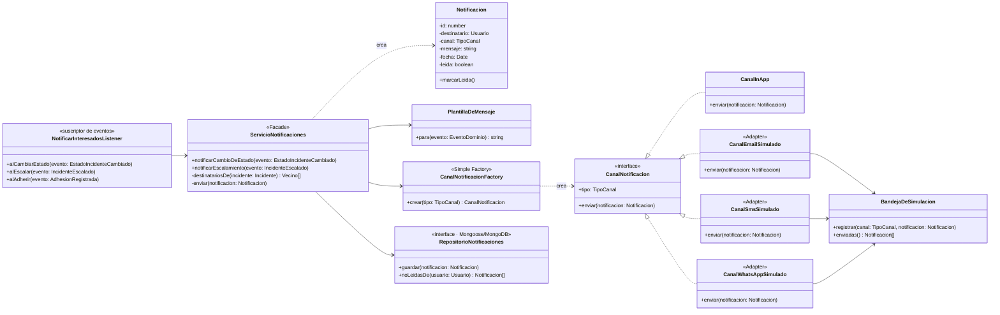

# Diagrama de clases — Módulo Notificaciones

**Estado:** propuesto. Este módulo depende de Incidentes, porque escucha sus eventos. Incidentes **no** lo conoce.

## Decisiones

- **Observer → suscripción a eventos**. El servicio de aplicación publica los eventos recién después de guardar el incidente, y el envío no bloquea la respuesta. Si un canal falla, la operación del operador no se revierte.
- **Facade**: `ServicioNotificaciones` es el único punto de entrada. Los listeners no saben de canales ni de plantillas.
- **Adapter**: los canales simulados tienen la misma interfaz que tendría un proveedor real. Para pasar a WhatsApp real alcanza con otra implementación de `CanalNotificacion`.
- **Simple Factory**: la elección del canal según la preferencia del vecino está en un solo lugar.
- **Persistencia en MongoDB**: `RepositorioNotificaciones` se implementa con Mongoose. El documento está en [der.md](der.md).
- In-app siempre se envía; además se usa el canal preferido del vecino si es distinto.
