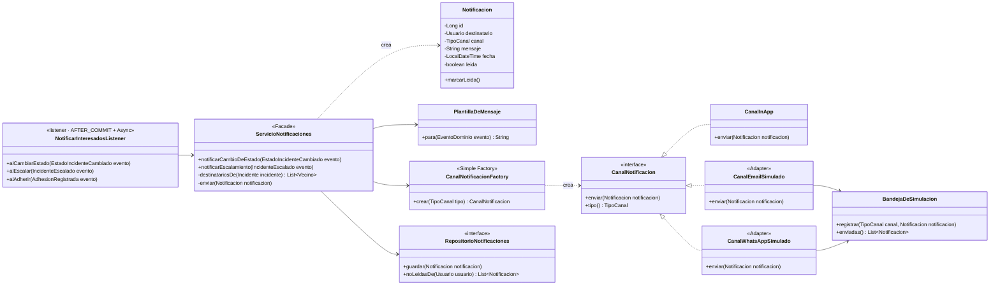

# Diagrama de clases — Módulo Notificaciones

**Estado:** propuesto (H3, I4). Este módulo depende de Incidentes, porque escucha sus eventos. Incidentes **no** lo conoce: lo verifica la regla `elDominioNoConoceAlModuloDeNotificaciones` de `ArquitecturaTest`.

## Decisiones

- **Observer → Pub/Sub en proceso** (C10). El listener corre después del commit (`@TransactionalEventListener(phase = AFTER_COMMIT)`) y en otro hilo (`@Async`). Si un canal falla, la operación del operador no se revierte (D7).
- **Facade** (C06): `ServicioNotificaciones` es el único punto de entrada. Los listeners no saben de canales ni de plantillas.
- **Adapter** (C06): los canales simulados tienen la misma interfaz que tendría un proveedor real. Para pasar a WhatsApp real alcanza con otra implementación de `CanalNotificacion`.
- **Simple Factory** (C06, mismo ejemplo `NotificadorFactory` de la clase): la elección del canal según la preferencia del vecino está en un solo lugar.
- In-app siempre se envía; además se usa el canal preferido del vecino si es distinto.
