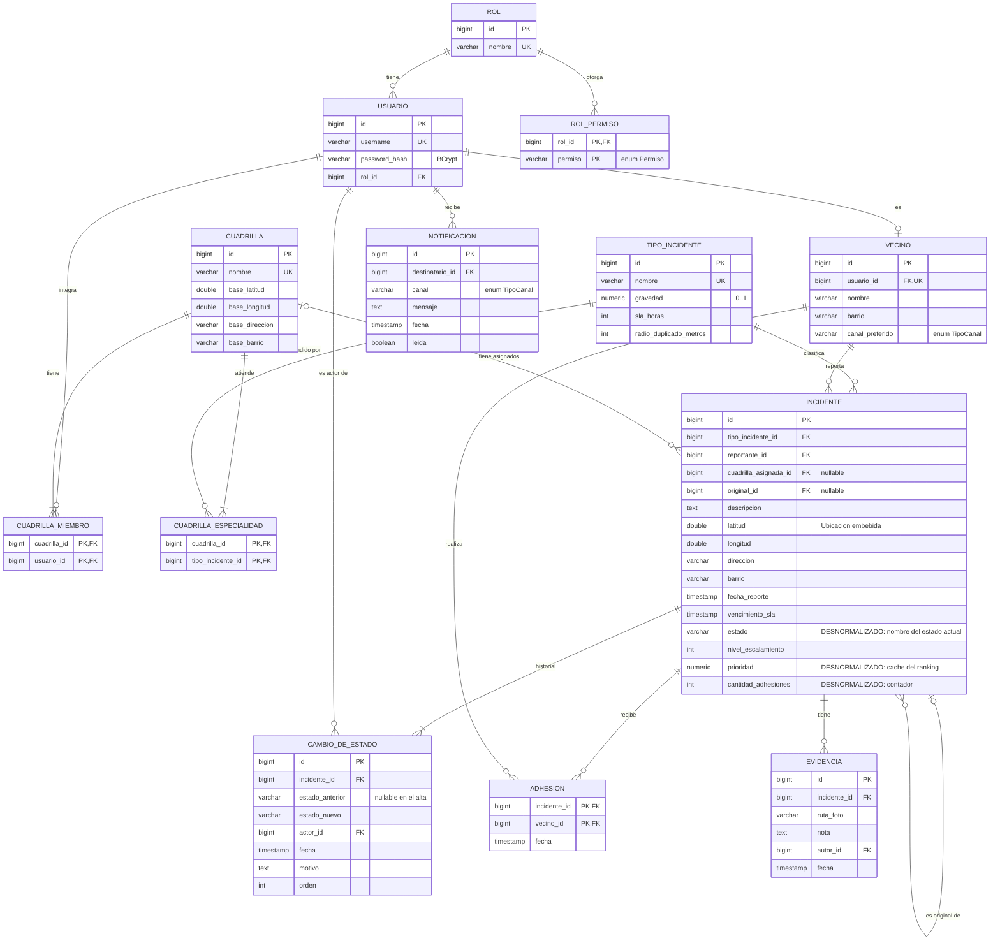

# DER físico (PostgreSQL) — propuesta v0

**Estado:** propuesto (H1, I7 + I1). Se materializa con migraciones Flyway en `backend/src/main/resources/db/migration`.

## Decisiones de mapeo (apunte ORM)

| Decisión | Justificación |
|---|---|
| `estado` como `varchar` con `AttributeConverter<EstadoIncidente, String>` usando `EstadoIncidente.desdeNombre` | Los estados son stateless: se persiste su nombre (apunte ORM, "mapeo de interfaces"). |
| `Ubicacion` embebida (`@Embeddable`) en `INCIDENTE` y `CUADRILLA` | Es un Value Object sin identidad. |
| `ADHESION` con PK compuesta (incidente, vecino) | La base garantiza la regla "nadie adhiere dos veces", además del dominio (validación en profundidad, C04). |
| `estado`, `prioridad` y `cantidad_adhesiones` **desnormalizados** | El mapa y el ranking se leen mucho más de lo que se escriben. El agregado mantiene la consistencia en el mismo método que modifica. |
| Índices: `incidente(estado)`, `incidente(latitud, longitud)`, `incidente(tipo_incidente_id, estado)`, `cambio_de_estado(incidente_id, orden)` | Consultas del mapa por caja delimitadora, de duplicados y del historial ordenado (RNF1). |
| `CAMBIO_DE_ESTADO.orden` | Conserva el orden de la lista `historial` (pendiente del apunte ORM: "persistencia en orden de los elementos de una lista"). |
| Sin herencia en tablas | `TipoIncidente` es un Type Object; no hay jerarquía que mapear. |
