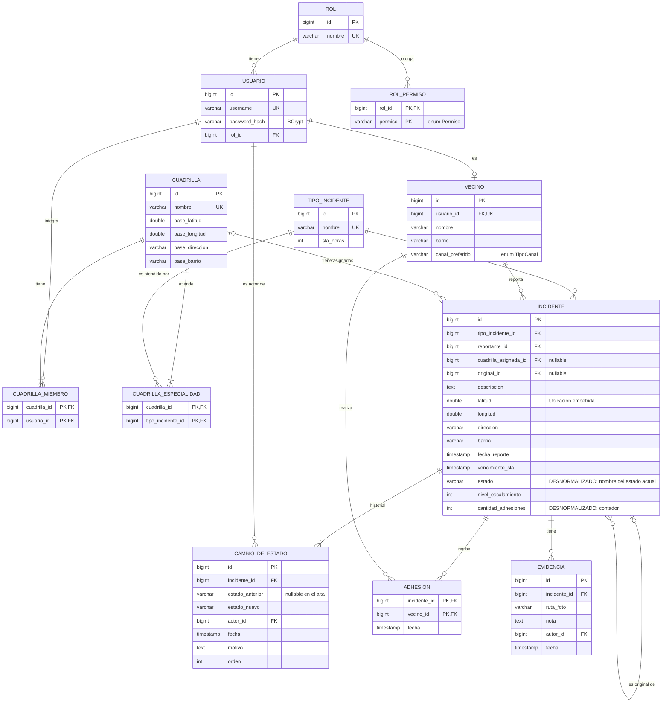

# Modelo de datos físico — propuesta v0

**Estado:** propuesto (H1, I7 + I1). Persistencia políglota, como pide la E4: todo en PostgreSQL con ORM, salvo Notificaciones, que va en MongoDB con ODM (al final de este archivo).

## PostgreSQL



## Decisiones de mapeo (apunte ORM)

| Decisión | Justificación |
|---|---|
| `estado` como `varchar`; al leer se reconstruye con `EstadoIncidente.desdeNombre` | Los estados son stateless: se persiste su nombre (apunte ORM, "mapeo de interfaces"). |
| `Ubicacion` embebida (columnas `latitud`, `longitud`, `direccion`, `barrio`) en `INCIDENTE` y `CUADRILLA` | Es un Value Object sin identidad. |
| `ADHESION` con PK compuesta (incidente, vecino) | La base garantiza la regla "nadie adhiere dos veces", además del dominio (validación en profundidad, C04). |
| `estado` y `cantidad_adhesiones` **desnormalizados** | El mapa y la bandeja se leen mucho más de lo que se escriben. El agregado mantiene la consistencia en el mismo método que modifica. |
| Índices: `incidente(estado)`, `incidente(latitud, longitud)`, `incidente(tipo_incidente_id, estado)`, `cambio_de_estado(incidente_id, orden)` | Consultas del mapa por caja delimitadora, de la bandeja por tipo y estado, y del historial ordenado. |
| `CAMBIO_DE_ESTADO.orden` | Conserva el orden de la lista `historial` (pendiente del apunte ORM: "persistencia en orden de los elementos de una lista"). |
| Sin herencia en tablas | `TipoIncidente` es un Type Object; no hay jerarquía que mapear. |

## MongoDB — colección `notificaciones` (módulo Notificaciones)

Un documento por notificación enviada. Se guarda con Mongoose (ODM).

```json
{
  "_id": "ObjectId",
  "destinatario": { "username": "vecina.ana", "nombre": "Ana" },
  "canal": "WHATSAPP",
  "mensaje": "Tu reclamo #101 fue asignado a la cuadrilla Norte",
  "incidente": { "id": 101, "tipo": "Bache", "estado": "ASIGNADO" },
  "evento": "EstadoIncidenteCambiado",
  "fecha": "2026-12-07T13:05:00Z",
  "leida": false
}
```

| Decisión | Justificación |
|---|---|
| Base documental para Notificaciones (pregunta de discusión de la E4) | Cada notificación es un registro independiente que solo se agrega y se lee por destinatario; no participa de relaciones que haya que mantener íntegras. |
| Destinatario e incidente **copiados** dentro del documento (no referencias) | La campana muestra la notificación sin consultar PostgreSQL. Es una foto del momento del envío: si el incidente cambia después, la notificación no debe cambiar. |
| Índice `{ "destinatario.username": 1, "leida": 1, "fecha": -1 }` | Consulta de la campana: no leídas de un usuario, las más nuevas primero. |
| Sin claves foráneas hacia PostgreSQL | Es el costo de separar bases: la consistencia la cuida el servicio de aplicación, que crea la notificación a partir del evento. |
