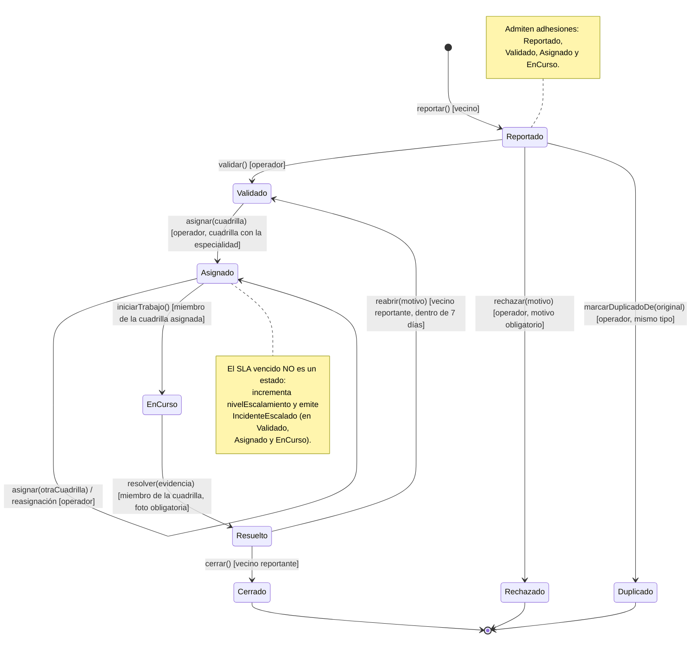

# Diagrama de estados — Incidente

**Estado:** implementado. Cada flecha es una fila de `TRANSICIONES` en
`backend/test/incidentes/tablaDeTransiciones.test.ts`. Cualquier combinación estado × acción que no aparezca acá lanza `TransicionInvalidaError` (HTTP 409).

## Reglas que no son transiciones

| Regla | Dónde vive |
|---|---|
| Toda transición registra `CambioDeEstado(anterior, nuevo, actor, fecha, motivo)` y emite `EstadoIncidenteCambiado` | `Incidente.cambiarEstado` (único punto de cambio) |
| Reabrir libera la cuadrilla asignada | `Resuelto.reabrir` |
| El SLA vence a las `slaHoras` del reporte; escala como máximo una vez por período de SLA | `Incidente.estaVencido`, `debeEscalar`, `escalar` |
