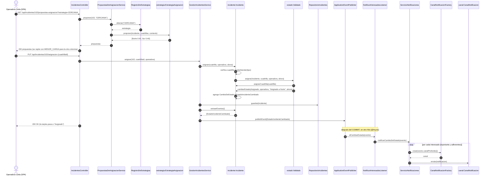

# Secuencia 2 — Asignar cuadrilla y notificar

**Estado:** propuesto (H2–H3, I3 + I4).
- **Ya implementados:** `Incidente.asignar`, `Validado.asignar`, `asignarCuadrilla`, `cambiarEstado`, `extraerEventos` y `EstadoIncidenteCambiado`.

Se ven dos ideas en el mismo flujo:
- **Strategy:** la operadora elige el algoritmo.
- **State:** el estado `Validado` decide la transición.

Y la notificación **no** bloquea ni revierte la asignación (D7).
