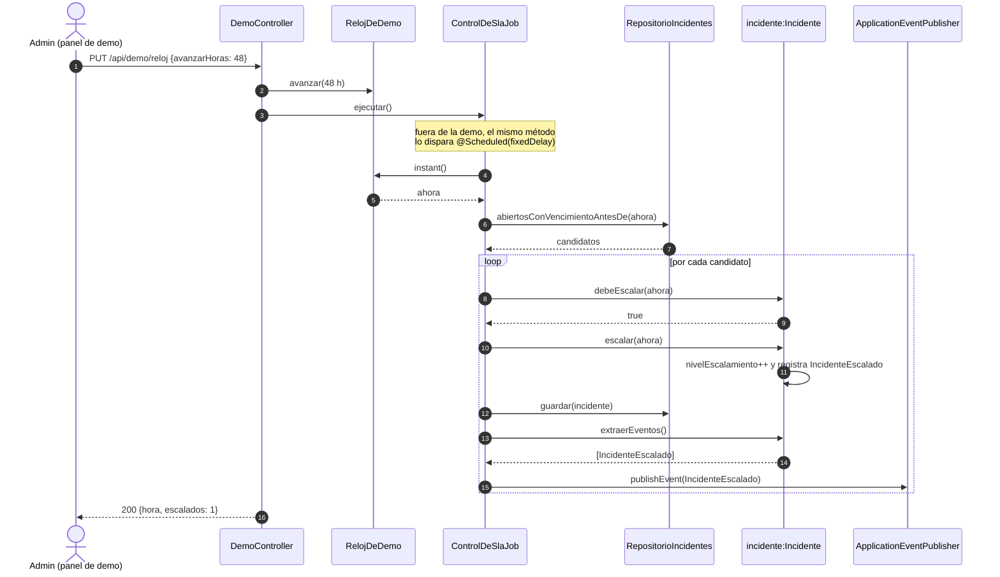

# Secuencia 3 — Escalamiento por SLA

**Estado:** propuesto (H3, I7).
- **Ya implementados:** `Incidente.debeEscalar`, `escalar`, `IncidenteEscalado` y `RelojDeDemo.avanzar`.

**Por qué es determinístico:** el job no pregunta la hora al sistema operativo, sino al `Clock` inyectado. En la demo ese reloj está congelado y solo avanza cuando el admin lo pide (D10).
