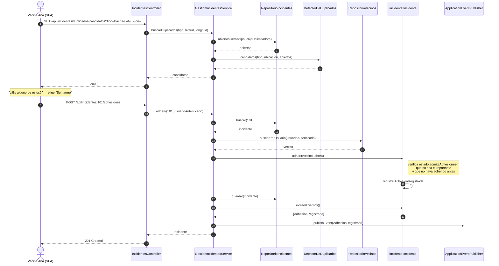

# Secuencia 1 — Reportar con duplicado (el vecino se suma)

**Estado:** propuesto (H2, I2).
- **Ya implementados** (los mensajes coinciden con el código): `Incidente.adherir`, `extraerEventos` y `AdhesionRegistrada`.
- **A crear:** servicios, repositorios y controller, con estos nombres.

`ahora` sale del `Clock` inyectado en el servicio (D10). Si `adherir` lanza `ReglaDeNegocioException`, el `ManejadorDeErrores` responde 422 y no se publica nada.
